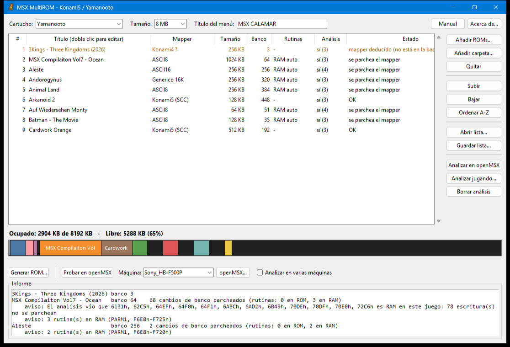
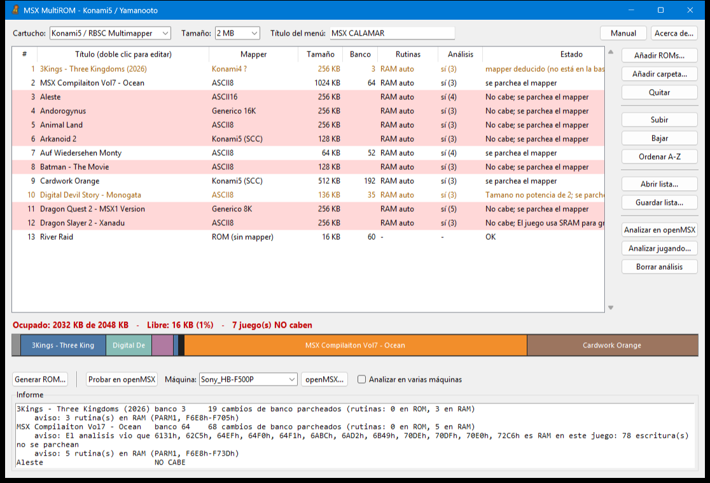
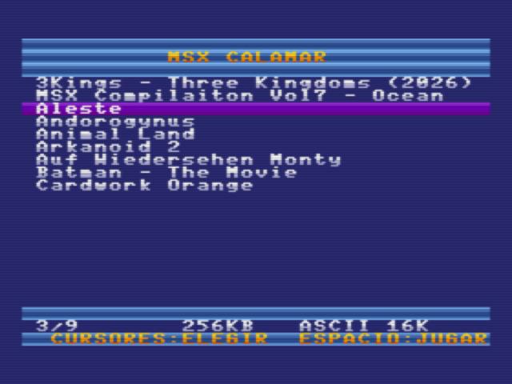
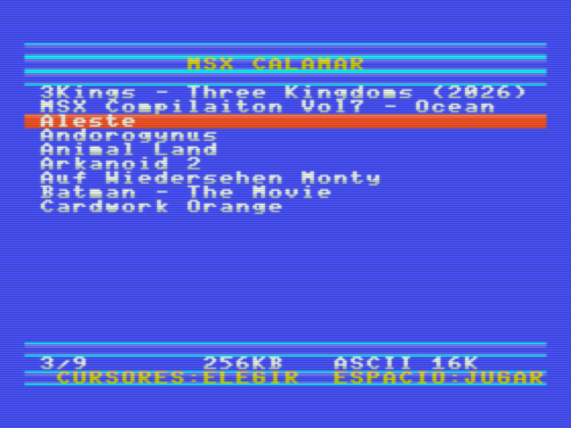
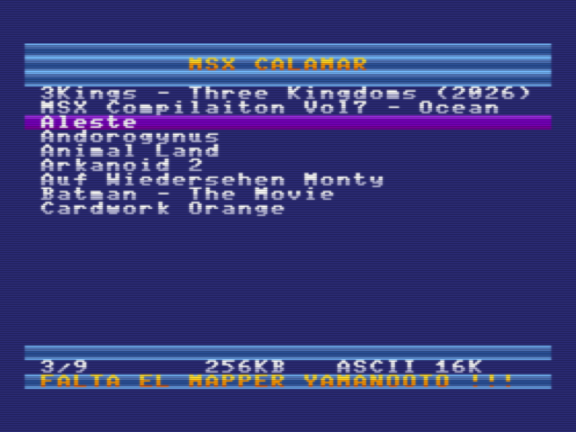
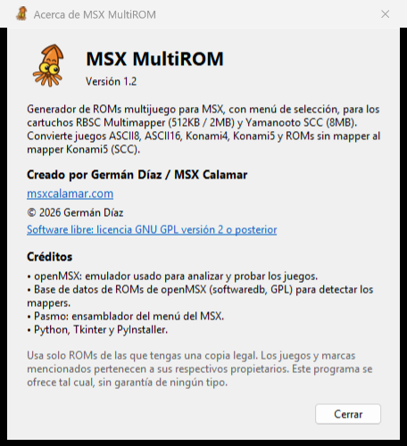

# Manual de uso de MSX MultiROM

**Versión 1.2** · Germán Díaz / MSX Calamar · [msxcalamar.com](https://msxcalamar.com)

MSX MultiROM junta varios juegos MSX en una sola ROM con un menú de selección,
lista para grabarla en un cartucho **RBSC Multimapper** (512KB o 2MB) o
**Yamanooto SCC** (hasta 8MB). Al encender el MSX aparece el menú, eliges el
juego con los cursores y pulsas ESPACIO para jugar.

## Índice

1. [Instalación](#1-instalación)
2. [Guía rápida](#2-guía-rápida)
3. [La ventana principal](#3-la-ventana-principal)
4. [Añadir y organizar los juegos](#4-añadir-y-organizar-los-juegos)
5. [Cuando no caben todos los juegos](#5-cuando-no-caben-todos-los-juegos)
6. [Probar en openMSX](#6-probar-en-openmsx)
7. [Analizar los juegos en openMSX](#7-analizar-los-juegos-en-openmsx)
8. [Rutinas de conversión](#8-rutinas-de-conversión)
9. [Generar la ROM y grabar el cartucho](#9-generar-la-rom-y-grabar-el-cartucho)
10. [El menú en el MSX](#10-el-menú-en-el-msx)
11. [Mensajes y avisos](#11-mensajes-y-avisos)
12. [Solución de problemas](#12-solución-de-problemas)
13. [Limitaciones](#13-limitaciones)
14. [Acerca de y licencia](#14-acerca-de-y-licencia)

---

## 1. Instalación

### Programa

1. Descarga `MultiROM.exe` de la [página de versiones](https://github.com/germandiazfuentes/msx-multirom-scc/releases/latest).
2. Guárdalo en una carpeta, por ejemplo `C:\MSX\MultiROM\`.
3. Haz doble clic para abrirlo. No hace falta instalar nada más: Python va incluido.

> **Aviso de Windows SmartScreen.** Como el programa no tiene firma digital,
> Windows puede avisar la primera vez. Pulsa **Más información → Ejecutar de
> todas formas**.

### openMSX (opcional, pero recomendado)

El emulador [openMSX](https://openmsx.org) sirve para dos cosas: **probar** la
ROM antes de grabarla y **analizar** los juegos para que funcionen mejor en el
cartucho RBSC. Sin openMSX se puede generar la ROM igualmente.

- Pon la carpeta de openMSX junto al programa (`C:\MSX\MultiROM\openmsx\openmsx.exe`),
  o pulsa **openMSX...** en el programa y elige `openmsx.exe`. Se recuerda para
  las siguientes veces.
- Para usar máquinas MSX reales (Sony, Panasonic, Philips...), copia sus ROMs
  de sistema en la carpeta `share\systemroms` de openMSX. Sin ellas solo están
  disponibles las máquinas **C-BIOS**.

### Usarlo con Python (alternativa)

Si tienes Python 3 instalado, también puedes descargar el código y ejecutar
`app\MultiROM.bat` o `python app\multirom_gui.py`.

---

## 2. Guía rápida

1. Elige el **Cartucho** (Konami5 / RBSC Multimapper o Yamanooto) y el **Tamaño**.
2. Escribe el **Título del menú**, el texto que aparece arriba en el MSX.
3. Pulsa **Añadir ROMs...** o **Añadir carpeta...** y elige los juegos.
4. *(Recomendado con el RBSC)* Pulsa **Analizar en openMSX** y espera a que termine.
5. Pulsa **Probar en openMSX** para comprobar el menú y algunos juegos.
6. Pulsa **Generar ROM...**, guarda el fichero `.rom` y grábalo en el cartucho.

---

## 3. La ventana principal

### Parte superior

| Control | Para qué sirve |
|---|---|
| **Cartucho** | Tipo de cartucho donde vas a grabar la ROM. Tiene que coincidir con el cartucho real. |
| **Tamaño** | Tamaño de la ROM: 512KB o 2MB para el RBSC; 512KB, 2MB, 4MB u 8MB para el Yamanooto. Usa el tamaño de tu cartucho. |
| **Título del menú** | Texto de la cabecera del menú en el MSX (hasta 32 caracteres). |
| **Manual** | Abre este manual en el navegador. |
| **Acerca de...** | Versión, autor, créditos y licencia. |

### Lista de juegos

| Columna | Significado |
|---|---|
| **#** | Orden en el menú del MSX. |
| **Título** | Nombre que se verá en el menú. Se saca del nombre del fichero; **doble clic** para cambiarlo (30 caracteres como máximo, sin acentos). |
| **Mapper** | Tipo de cartucho original del juego: Konami4, Konami5 (SCC), ASCII8, ASCII16, Genérico 8K/16K o ROM (sin mapper). Si termina en **`?`**, el juego no está en la base de datos y el mapper se ha deducido: compruébalo. **Doble clic** para cambiarlo. |
| **Tamaño** | Tamaño del juego. |
| **Banco** | Posición del juego dentro de la ROM, en bancos de 8KB. Vacía si el juego no cabe. |
| **Rutinas** | Dónde van las rutinas que adaptan el juego al cartucho (ver [sección 8](#8-rutinas-de-conversión)). **Doble clic** para cambiarlo. Un guion (`-`) indica que el juego no necesita adaptación. |
| **Análisis** | `sí` si el juego se ha analizado en openMSX; `sí (3)` indica que se ha analizado 3 veces (en varias máquinas o pasadas). |
| **Estado** | `OK` o los avisos de ese juego (ver [sección 11](#11-mensajes-y-avisos)). |

Colores de las filas:

- **Negro:** todo correcto.
- **Naranja:** hay un aviso que conviene revisar.
- **Rojo:** el juego no se puede usar (formato no soportado o fichero dañado).
- **Fondo rojo:** el juego no cabe en el tamaño elegido.

### Barra de ocupación

Debajo de la lista, una barra muestra cómo queda repartida la ROM. El gris de
la izquierda es el menú, cada juego tiene un color y lo negro es espacio libre.
Encima aparecen el espacio ocupado y el libre. **Pasa el ratón por la barra**
para ver qué juego ocupa cada zona.

### Botones de la parte inferior

| Botón | Para qué sirve |
|---|---|
| **Generar ROM...** | Crea la ROM final y la guarda en disco. |
| **Probar en openMSX** | Abre la ROM en openMSX con la máquina elegida. |
| **Máquina** | Máquina MSX de openMSX para probar y analizar. |
| **openMSX...** | Indica dónde está `openmsx.exe`. |
| **Analizar en varias máquinas** | Al analizar, usa además una MSX1, una MSX2, una MSX2+ y una turbo R con BIOS real (ver [sección 7](#7-analizar-los-juegos-en-openmsx)). |

### Informe

El recuadro inferior muestra el resultado de la última acción: el progreso de
un análisis o, al generar la ROM, el banco de cada juego, cuántos cambios de
banco se han adaptado y los avisos. Las líneas con **ERROR** indican juegos
que probablemente no funcionarán.

---

## 4. Añadir y organizar los juegos

### Formatos admitidos

- Ficheros `.rom`, `.mx1`, `.mx2` y `.bin`.
- Ficheros `.zip` con una ROM dentro: no hace falta descomprimirlos.
- Mappers: **Konami4, Konami5 (SCC), ASCII8, ASCII16, Genérico 8K/16K** y
  ROMs sin mapper de hasta 64KB. Todos se convierten al formato del cartucho.

### Botones de la lista

| Botón | Acción |
|---|---|
| **Añadir ROMs...** | Elige uno o varios ficheros. |
| **Añadir carpeta...** | Añade todas las ROMs de una carpeta. |
| **Quitar** | Quita los juegos seleccionados (también con la tecla Supr). |
| **Subir / Bajar** | Cambia el orden de los juegos seleccionados. |
| **Ordenar A-Z** | Ordena la lista alfabéticamente. |
| **Abrir lista... / Guardar lista...** | Guarda la lista en un fichero `.json` (juegos, títulos, mappers y opciones) para rehacer la ROM más adelante. |

Se pueden seleccionar varios juegos a la vez con **Ctrl** o **Mayús**.

> El programa recuerda el tipo de cartucho, el tamaño, el título, la máquina
> y la ruta de openMSX entre sesiones.

---

## 5. Cuando no caben todos los juegos

Si los juegos ocupan más que el cartucho, los que no caben aparecen **con fondo
rojo**. El texto de ocupación se pone en rojo e indica cuántos quedan fuera.
Esos juegos no se incluyen en la ROM.

Soluciones:

- Quita algún juego grande o cambia el orden: los juegos se colocan por orden
  de la lista y aprovechando los huecos.
- Elige un tamaño mayor si tu cartucho lo admite.
- Reparte los juegos en varias ROMs.

---

## 6. Probar en openMSX

**Probar en openMSX** crea la ROM en un fichero temporal y la abre en openMSX
con la **Máquina** elegida y con el tipo de cartucho correcto. Es la forma más
rápida de comprobar el menú y los juegos antes de grabar el cartucho.

- Prueba con una máquina parecida a la tuya (MSX1, MSX2...). Las máquinas
  **C-BIOS** no tienen BASIC y algunos juegos no arrancan con ellas, ni
  siquiera solos.
- Si abres la ROM en openMSX a mano, **indica el tipo de cartucho**:
  `KonamiSCC` para el RBSC y `Yamanooto` para el Yamanooto. Si no se indica,
  openMSX trata las ROMs de Yamanooto como KonamiSCC y el menú muestra
  **FALTA EL MAPPER YAMANOOTO** (ver [sección 10](#10-el-menú-en-el-msx)).
- Algunos emuladores web, como WebMSX, detectan el tipo de cartucho
  automáticamente.

---

## 7. Analizar los juegos en openMSX

### Para qué sirve

Para que un juego funcione en el cartucho, el programa adapta sus **cambios de
banco**. Normalmente los encuentra leyendo el código del juego, pero algunos
juegos los hacen de formas que no se ven así: calculan la dirección o los
ejecutan desde RAM. Además, las rutinas de adaptación necesitan una zona de RAM
que el juego no use.

El análisis **ejecuta cada juego original en openMSX** y apunta:

- todos los cambios de banco que hace realmente;
- qué zonas de RAM deja libres.

Con esa información el programa adapta los cambios de banco que faltaban y
coloca las rutinas en una zona segura. En la columna Rutinas aparece **RAM auto**.

**Cuándo usarlo:**

- **Cartucho RBSC:** recomendado siempre. Este cartucho necesita adaptar todos
  los cambios de banco, y algunos juegos (por ejemplo Hydlide 3) solo funcionan
  con el análisis.
- **Cartucho Yamanooto:** se necesita menos, porque el cartucho hace gran parte
  del trabajo. Aun así es útil con juegos ASCII16 o Genérico 16K.

### Botones

| Botón | Qué hace |
|---|---|
| **Analizar en openMSX** | Analiza los juegos seleccionados (o todos si no hay ninguno seleccionado) sin abrir ventanas. Cada juego se ejecuta 90 segundos de juego simulado, pulsando teclas para pasar de pantalla. Tarda unos 20 segundos por juego. |
| **Analizar jugando...** | Abre openMSX con el juego seleccionado para que **juegues tú**. Pasa por el mayor número de fases, menús y pantallas que puedas, y cierra openMSX al terminar. Sirve cuando un juego falla más adelante (en la fase 3, al grabar partida...). |
| **Borrar análisis** | Olvida el análisis de los juegos seleccionados. |

### Consejos

- **Usa una máquina con BIOS real**, por ejemplo `Sony_HB-F1XD` o
  `Panasonic_FS-A1WX`, mejor que C-BIOS. La BIOS y el BASIC reales usan
  zonas de RAM que C-BIOS no toca, y algunos juegos se comportan distinto.
- Marca **Analizar en varias máquinas** para analizar a la vez en la máquina
  elegida y en una MSX1, una MSX2, una MSX2+ y una turbo R (las que tengan sus
  ROMs en openMSX). Tarda más (unos 20 segundos por juego y máquina), pero el
  resultado vale para cualquier MSX.
- Los análisis **se suman** y se guardan en
  `%USERPROFILE%\.msx_multirom\analisis`, así que cada juego solo hay que
  analizarlo una vez, aunque lo uses en varias ROMs.
- Si un juego falla después de analizarlo, analízalo con **Analizar jugando...**
  hasta el punto donde falla y genera la ROM de nuevo.

---

## 8. Rutinas de conversión

En el cartucho, los cambios de banco de los juegos no Konami5 se sustituyen por
llamadas a unas pequeñas **rutinas** que hacen el cambio en el formato del
cartucho. El menú las copia a la RAM antes de lanzar el juego. La columna
**Rutinas** indica dónde van:

| Valor | Significado |
|---|---|
| **RAM auto** | Zona de RAM elegida automáticamente según el análisis. **Es la mejor opción.** |
| **RAM PARM1** | Zona del BASIC que los juegos en cartucho no suelen usar. Es la opción por defecto sin análisis. |
| **RAM HOOKS / KBUF / FNKSTR / BUF / HIMEM** | Otras zonas de RAM del sistema, para elegir a mano. |
| **ROM** | En huecos libres del propio juego, sin usar RAM. Solo vale si el juego cambia de banco desde la ROM. |
| **-** | El juego no necesita rutinas. |

Normalmente no hay que tocar nada. Si un juego **sin analizar** se cuelga o
hace cosas raras, analízalo. Si no puedes analizarlo, prueba otras zonas con
doble clic en la columna Rutinas.

---

## 9. Generar la ROM y grabar el cartucho

1. Pulsa **Generar ROM...**.
2. Elige dónde guardarla. El nombre propuesto indica el cartucho y el tamaño,
   por ejemplo `multirom_k5_2MB.rom` o `multirom_yama_8MB.rom`.
3. Un mensaje confirma el fichero y el **tipo de mapper** con el que hay que
   usarla (`KonamiSCC` o `Yamanooto`).
4. Revisa el **Informe**: los juegos marcados con **ERROR** probablemente no
   funcionarán.
5. Graba el fichero `.rom` en el cartucho con la herramienta habitual de tu
   cartucho RBSC o Yamanooto.

La ROM siempre tiene el tamaño elegido. Si sobra espacio, se rellena.

---

## 10. El menú en el MSX

Al encender el MSX con el cartucho aparece el menú:

| MSX2 / MSX2+ / turbo R | MSX1 |
|---|---|
|  |  |

| Tecla | Acción |
|---|---|
| **Cursor arriba / abajo** | Elegir juego (al llegar al final vuelve al principio). |
| **Cursor izquierda / derecha** | Página anterior / siguiente. |
| **ESPACIO, RETURN o disparo del joystick** | Jugar. |

El joystick también sirve para moverse por el menú. La línea inferior muestra
la posición del juego en la lista, su tamaño y su mapper original.

- **MSX1:** colores degradados.
- **MSX2 y superiores:** paleta propia y barra de selección animada. Antes de
  lanzar el juego se restaura la paleta normal.
- **turbo R:** antes de lanzar el juego se pasa a modo Z80, el compatible con
  los juegos antiguos.
- **Volver al menú:** apaga y enciende el MSX. El botón de reset solo vuelve al
  menú si el cartucho reinicia su mapper con la señal de reset.

### Aviso "FALTA EL MAPPER YAMANOOTO"

Aparece cuando una ROM generada para **Yamanooto** se usa en un cartucho o
emulador que no es Yamanooto. Por ejemplo, en openMSX cargada sin indicar el
tipo, o grabada en un cartucho SCC normal. El menú no lanza los juegos porque
no arrancarían. Usa la ROM en un Yamanooto, o genérala para el cartucho RBSC.

---

## 11. Mensajes y avisos

### En la columna Estado

| Mensaje | Qué significa | Qué hacer |
|---|---|---|
| `OK` | Todo correcto. | Nada. |
| `se parchea el mapper` | El juego se adapta al cartucho. Es normal. | Con el RBSC, analízalo. |
| `mapper deducido (no está en la base de datos): compruébalo` | El programa ha adivinado el mapper. | Comprueba que el juego funciona; si no, cambia el mapper con doble clic. |
| `No cabe` | No hay espacio para el juego. | Ver [sección 5](#5-cuando-no-caben-todos-los-juegos). |
| `posible fallo: Colocado donde un banco 63 (mod 64) puede activar el SCC sin querer...` | Por la posición del juego, un cambio de banco podría activar el chip de sonido SCC por error. | Si falla, cambia el orden o deja más espacio libre. |
| `El juego usa SRAM para grabar; no funcionara la grabacion` | El juego original grababa partidas en el cartucho. | El juego funciona, pero no puede grabar. Algunos no arrancan. |
| `Tamano no potencia de 2` | El fichero tiene un tamaño poco habitual. | Suele funcionar; si no, busca otra copia del juego. |
| `el análisis no vio arrancar el juego` | El juego no llegó a arrancar durante el análisis. | Prueba con otra máquina (con BIOS real). |

### Errores que impiden usar un juego (texto en rojo)

| Mensaje | Causa |
|---|---|
| `Mapper no soportado` | El juego usa un tipo de cartucho que no se puede convertir. |
| `Juego de mas de 2MB` | El juego es demasiado grande para el formato Konami5. |
| `ROM sin mapper de mas de 64KB` | El fichero no es una ROM sin mapper válida. |
| `ROM de BASIC (no soportada)` | El juego está en BASIC. |
| `No se encuentra la cabecera 'AB'...` | El fichero no es una ROM de cartucho MSX. |
| `El zip no contiene ninguna ROM` / `Fichero vacio` | Fichero incorrecto o dañado. |

### En el Informe, al generar la ROM

| Mensaje | Qué significa |
|---|---|
| `N cambios de banco parcheados (rutinas: X en ROM, Y en RAM)` | Cuántos cambios de banco se han adaptado. Es normal. |
| `..., N gracias al análisis` | Cambios de banco que solo se encontraron gracias al análisis. |
| `aviso: N rutina(s) en RAM (zona, direcciones)` | Dónde van las rutinas. Informativo. |
| `ERROR: Probablemente no funcione: hay rutinas en RAM y el juego escribe en todas las areas de RAM candidatas` | El juego usa toda la RAM y no queda sitio seguro para las rutinas. Suele fallar. |
| `ERROR: No caben mas rutinas en el area de RAM ...` | La zona de RAM elegida es pequeña. Elige otra en la columna Rutinas. |

---

## 12. Solución de problemas

**Un juego no arranca o se cuelga desde el menú.**

1. Comprueba que el juego original funciona en esa máquina, cargándolo solo
   en openMSX. Algunos juegos no funcionan en ciertos modelos. Por ejemplo,
   River Raid no funciona en el Sony HB-F500P ni siquiera solo.
2. Analízalo con **Analizar en openMSX**, mejor con una máquina con BIOS real
   o con **Analizar en varias máquinas**, y genera la ROM de nuevo.
3. Si falla más adelante en la partida, usa **Analizar jugando...** hasta ese punto.
4. Con el cartucho RBSC, si sigue fallando, prueba en un Yamanooto: es más compatible.

**En openMSX el menú no responde al teclado después de un reset.**
Si haces el reset con el ratón desde el menú de openMSX, el teclado puede
quedarse en el menú de openMSX. Haz clic en la pantalla del MSX y vuelve a
probar.

**En openMSX sale "FALTA EL MAPPER YAMANOOTO".**
La ROM es para Yamanooto y se ha cargado sin ese tipo. Usa **Probar en
openMSX** o carga la ROM con el tipo `Yamanooto`.

**Al elegir un juego aparece "Syntax error" o se vuelve al BASIC.**
Puede ser que la ROM se use con un mapper que no le corresponde (ver el punto
anterior), o que el juego no sea compatible con esa máquina (ver el primer punto).

**Los botones de openMSX no hacen nada o piden la ruta de openMSX.**
Pulsa **openMSX...** y elige `openmsx.exe`.

**En la lista de máquinas solo aparecen las C-BIOS.**
Faltan las ROMs de sistema de las máquinas reales en la carpeta
`share\systemroms` de openMSX.

**Windows no deja abrir MultiROM.exe.**
Es el aviso de SmartScreen para programas sin firma: **Más información →
Ejecutar de todas formas**.

---

## 13. Limitaciones

- **Juegos con SRAM** (Koei, Xanadu...): no pueden grabar partida y algunos,
  como Nobunaga no Yabou, no arrancan.
- **Juegos de más de 2MB** y recopilatorios con mapper propio (Zemina,
  30-in-1...) no se pueden convertir.
- **Juegos que borran toda la RAM** y no tienen hueco en su ROM para las
  rutinas (Legend Compilation, y Auf Wiedersehen Monty en el RBSC). El informe
  los marca con ERROR.
- **Cartucho RBSC:** los juegos que calculan la dirección del cambio de banco
  solo funcionan si se han analizado y el análisis llegó a esa parte del juego.
- **ROMs de 48/64KB** con datos en las direcciones 0000h-3FFFh o C000h-FFFFh,
  y ROMs de BASIC.
- Algunos juegos concretos (Nogalious en algunas máquinas, Safari Kids en el
  RBSC) tienen problemas conocidos que no se pueden corregir.

---

## 14. Acerca de y licencia

MSX MultiROM ha sido creado por **Germán Díaz / MSX Calamar**
([msxcalamar.com](https://msxcalamar.com)).

Es **software libre** bajo la licencia **GNU GPL versión 2 o posterior**: puedes
usarlo, estudiarlo, modificarlo y redistribuirlo, siempre que las versiones
que distribuyas mantengan la misma licencia y su código fuente. Se ofrece sin
ninguna garantía. El texto completo está en el fichero
[`LICENSE`](../LICENSE) y el código en
[github.com/germandiazfuentes/msx-multirom-scc](https://github.com/germandiazfuentes/msx-multirom-scc).

**Créditos:** openMSX (emulador usado para analizar y probar los juegos, y su
base de datos de ROMs), Pasmo (ensamblador del menú), Python, Tkinter y PyInstaller.

Usa solo ROMs de las que tengas una copia legal. Los juegos y marcas
mencionados pertenecen a sus respectivos propietarios.
